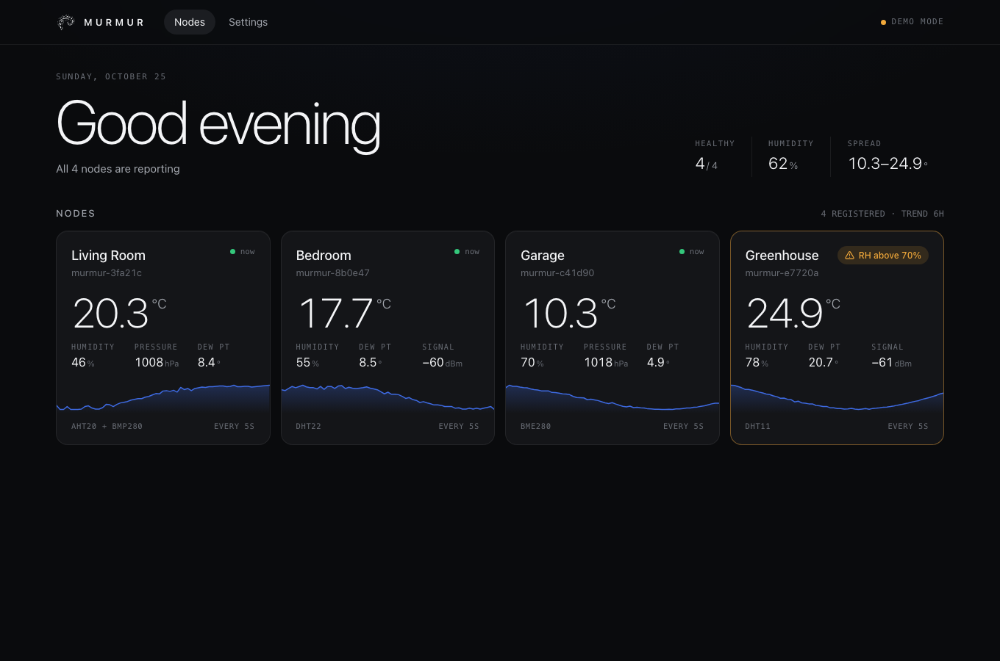
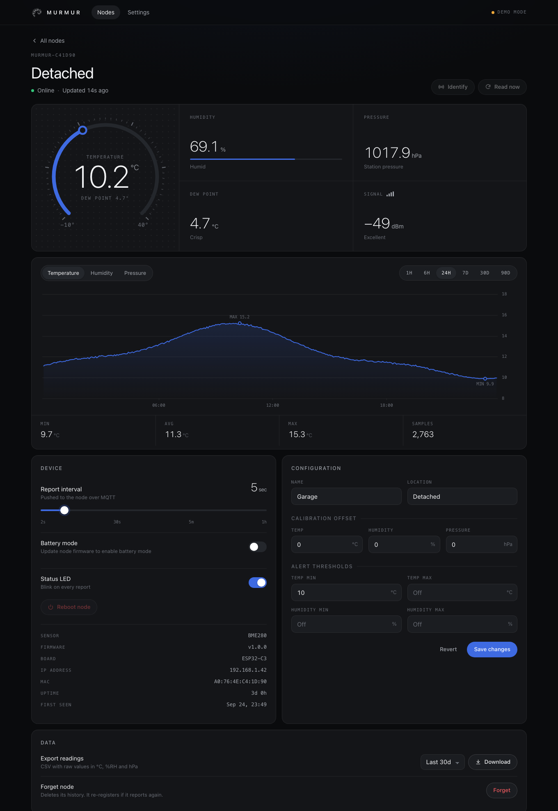
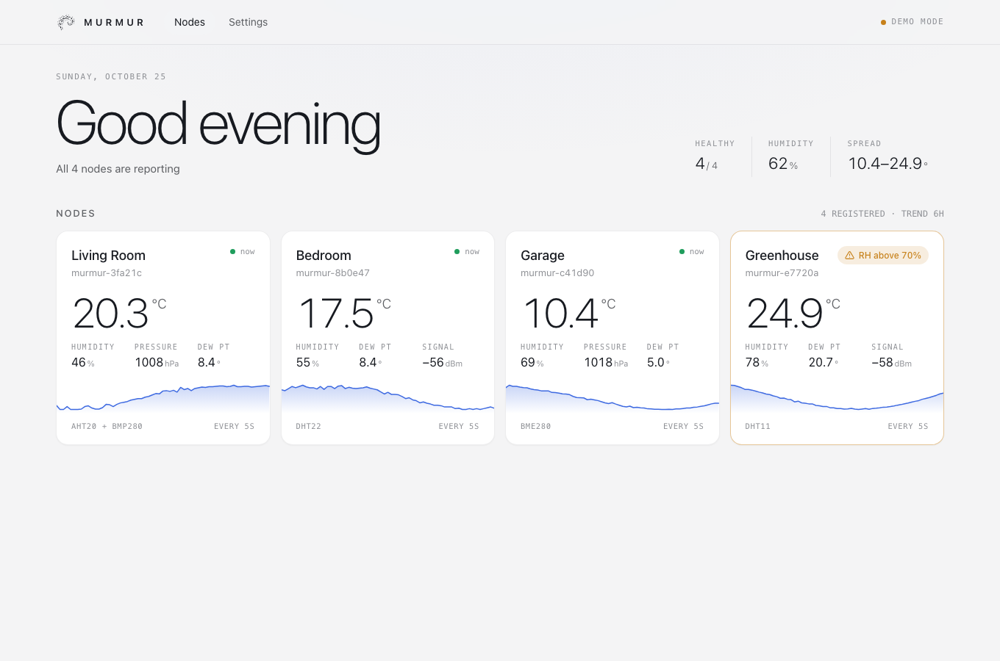

<p align="center">
  <picture>
    <source media="(prefers-color-scheme: dark)" srcset="docs/logo-dark.svg">
    
  </picture>
</p>

<h1 align="center">murmur-core</h1>

<p align="center">The hub for a flock of home climate sensors.<br>
MQTT broker, history and a live dashboard, packaged as Docker containers.</p>

<p align="center"></p>

Sensor nodes running **[murmur-node](https://github.com/alexcyterski/murmur-node)** publish temperature,
humidity and pressure over MQTT. murmur-core receives them, stores the history in SQLite, and serves a
dashboard on port **8090**. New nodes appear on the dashboard as soon as they report.

## Quick start

```bash
git clone https://github.com/alexcyterski/murmur-core && cd murmur-core
docker compose up -d --build
```

Open `http://<pi-address>:8090`. Nodes publish to the bundled Mosquitto broker on port `1883`.

If you don't have a node yet, add `MURMUR_DEMO=1` to that `docker compose up` command to load four simulated ones.
Run `docker compose down -v` afterwards to clear the demo data.

## Features

- **Live dashboard**: readings arrive over a WebSocket. Each node card has a sparkline, dew point and Wi-Fi signal.
- **History**: charts from 1 hour to 90 days, min/avg/max stats, and CSV export.
- **Node control**:
  - Changes made on the dashboard are pushed to the node over MQTT: report interval, status LED, name and battery mode.
  - You can also ask a node to *identify* itself (blink its LED), read now, or reboot.
- **Battery mode**: compatible nodes sleep between reports and appear as *Sleeping* while healthy. Configuration waits for their next wake; press RESET on the node for a five-minute command/OTA window. Enabling battery mode defaults to at least a five-minute interval; disabling it restores 30 seconds.
- **Glitch filtering**: a reading that jumps implausibly far from the node's previous one (10 °C, 25 % RH or 20 hPa) is ignored. A second reading that agrees with it is accepted, so real changes still come through.
- **Per-node settings**: calibration offsets and high/low alert thresholds.
- **Preferences**: units (°C/°F, hPa/inHg/mmHg/kPa), dark/light theme, accent colour, how long to keep history, how often to store points, and when a node counts as offline.
- **API**: REST endpoints with interactive docs at `/api/docs`.

<p align="center"> </p>

## Configuration

Set these as environment variables on the `core` service in `docker-compose.yml`:

| Variable | Default | |
|---|---|---|
| `MQTT_HOST` / `MQTT_PORT` | `mosquitto` / `1883` | Point at an existing broker to drop the bundled one |
| `MQTT_USERNAME` / `MQTT_PASSWORD` | empty | Broker credentials |
| `MQTT_BASE_TOPIC` | `murmur` | Must match the nodes' topic root |
| `MURMUR_DEMO` | `0` | Simulated nodes |

The broker allows anonymous connections by default, which is fine on a trusted home LAN.
[`mosquitto/config/mosquitto.conf`](mosquitto/config/mosquitto.conf) shows how to require a password.

The MQTT topics and payloads are documented in [docs/protocol.md](docs/protocol.md).
The logo is generated by [tools/murmuration.py](tools/murmuration.py).

## Development checks

In a Python virtual environment:

```bash
pip install -r requirements-dev.txt
python -m unittest discover -s tests -v
```
